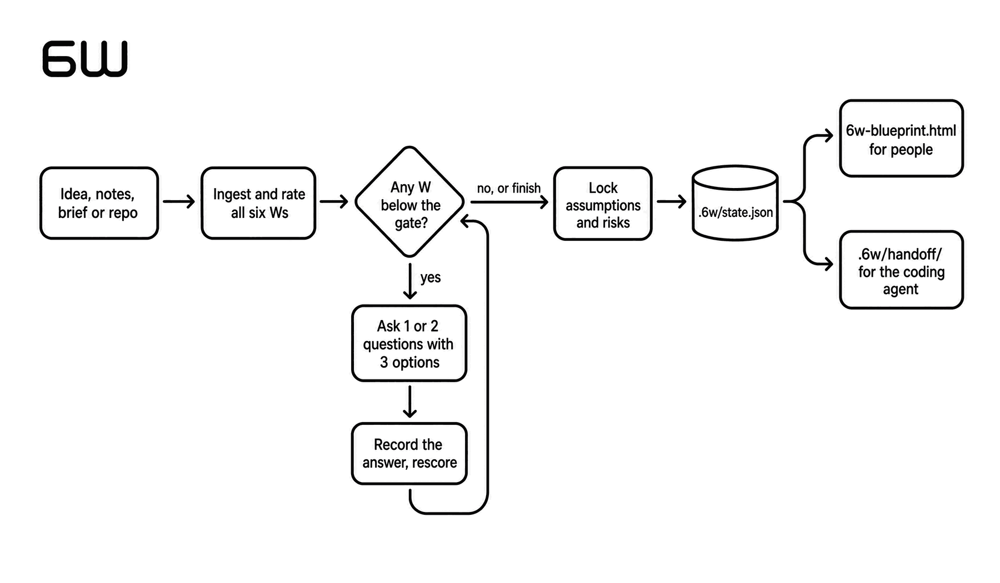

<p align="center">
  <picture>
    <source media="(prefers-color-scheme: dark)" srcset="assets/logo/6w-mark-dark.svg" />
    
  </picture>
</p>

<h3 align="center">Give your idea a foundation before you build.</h3>

<p align="center">An open-source agent skill. It walks you through Why, Who, What, Which, Whether and When before any code is written, scores how ready each decision is without flattering you, and hands your coding agent a plan it can execute.</p>

## Status

This repository holds the master blueprint, the skill, and the scripts that make it deterministic: scoring, validation, state save and resume, diagrams, and the export of the HTML blueprint plus the Markdown handoff. A worked demo is live as a page. The scripts and the export ran on Claude Code, and `docs/compatibility.md` records the result. Nobody has yet recorded a test of installing through a marketplace or of the skill activating on its own, on any host. The remaining plan is in `docs/plans/0001-v0.1-implementation.md`.

## What it does

You bring an idea, some notes, a brief or a repository. 6W reads it, drafts six decisions with their provenance, shows you a scoreboard, and asks one or two questions per turn with concrete options. You can skip, go deeper, change your mind, or finish at any time. If you finish early, the package says which sections are unresolved instead of filling them in.

<p align="center"></p>

Two outputs come from one state file:

- `6w-blueprint.html`. One offline file for people. Readiness, canvas, persona and edge-case cards, marketing hypotheses, scope, unit economics, delivery plan, risks, stack options and diagrams. It loads nothing from a CDN, reads without JavaScript, and prints. [See the MenuLens example](https://pongsiritk.github.io/6w/demo/menulens/).
- `.6w/handoff/`. Token-dense Markdown for your coding agent. Requirements with acceptance criteria, architecture, an ordered task list, decisions, risks and a guardrail file. [See the MenuLens handoff](docs/demo/menulens/handoff/START-HERE.md).

The scoreboard you see every turn:

```text
6W PRODUCT FOUNDATION                      gate 90   stage: build MVP   mode: quick
overall 61/100  [############........]

  W        score  status  evidence     note
  WHY       94    OK      assumption   Invoice reconciliation for boutique agencies
  WHO       91    OK      user         Agencies of 5 to 20 staff on Xero
  WHAT      65    CAP     assumption   Seven features and no anti-scope list (capped at 65)
  WHICH     85    ..      assumption   Web dashboard plus Slack approval bot
  WHETHER   40    CAP     unknown      Paid OCR with no cost per active user
  WHEN      30    ..      unknown      Two weeks, not mapped to scope
```

Each W has four named sub-criteria. Hard caps stop a vague idea from scoring 95. For a commercial project in deep mode, a weak value-capture rating pulls in a pricing reference that makes the agent choose the unit the price scales with before it names a price. The score and the evidence are separate fields, so "the user agreed" cannot turn into "this is proven".

## Demo

**Open the rendered blueprint: [pongsiritk.github.io/6w/demo/menulens](https://pongsiritk.github.io/6w/demo/menulens/)**

That page is `6w-blueprint.html` exported by `skills/6w/scripts/export.mjs` from `examples/menulens-complete/state.json`. It is one file with inline CSS and SVG, no CDN, no font download, readable with JavaScript disabled, and it prints. The Markdown handoff from the same export is next to it, starting at [START-HERE.md](docs/demo/menulens/handoff/START-HERE.md). A test fails if either drifts from the state that produced them.

`examples/` holds the worked session behind it: MenuLens, a menu scanner for travelers with food allergies. The naive version trips every hard cap. The refined version clears them in eleven turns. Both state files validate and their scores are produced by the scripts, so you can rerun them:

```bash
node skills/6w/scripts/score.mjs examples/menulens-partial/state.json
node skills/6w/scripts/score.mjs examples/menulens-complete/state.json
node skills/6w/scripts/validate.mjs examples/menulens-complete/state.json
node skills/6w/scripts/export.mjs examples/menulens-complete/state.json /tmp/menulens-demo
```

The session is synthetic, authored to exercise the rubric. `examples/README.md` has both scoreboards, the turn log and what the demo does and does not show.

## Where the name comes from

6W adapts the Five Ws, the Who, What, When, Where, Why and How that journalists and Kipling's "six honest serving-men" have used for over a century. Where becomes Which, because a product chooses a platform and a channel. How goes, since building it is the coding agent's job after the handoff. Whether is new: a product plan needs a go or no-go gate, and the original set has none.

## Install

These commands follow each host's documented convention. None has a recorded test yet. See `docs/compatibility.md` and report what you find.

Claude Code:

```text
/plugin marketplace add PongsiriTK/6w
/plugin install 6w@6w
```

Cursor, Codex and other hosts that read the Agent Skills convention:

```bash
npx skills add PongsiriTK/6w
```

Manual: copy `skills/6w/` into your host's skills directory.

## Use

Say any of these to your agent:

- "Use 6W to help me develop this idea."
- "Review this brief with 6W."
- "Resume the 6W foundation for this project."
- "Finish now and export the blueprint."

Or, where the host supports commands, `/6w`, `/6w quick`, `/6w deep`, `/6w roast`, `/6w personas`, `/6w skip`, `/6w finish`, `/6w audit`.

## What is inside

| Path | Content |
| --- | --- |
| `BLUEPRINT.md` | The master specification: framework, conversation design, rubric, outputs, system design, repository layout, acceptance criteria and open decisions |
| `skills/6w/SKILL.md` | The portable skill every host loads |
| `skills/6w/references/scoring-rubric.md` | Sub-criteria, anchors, caps and the formula |
| `skills/6w/references/pricing-models.md` | Value metric, pricing model and experiments for commercial projects, read on demand |
| `skills/6w/references/persona-edge-matrix.md`, `interview-examples.md`, `stack-archetypes.md` | Persona and edge-case rules, a strong question per sub-criterion, and stack patterns with the unit-economics table |
| `tests/fixtures/` | Six behavioral cases with input, review notes, expected state and invariants |
| `skills/6w/scripts/` | `score.mjs` scores and prints the scoreboard, `validate.mjs` checks a state file, `state.mjs` saves, checkpoints and migrates, `diagrams.mjs` handles archify and the SVG fallback, `render.mjs` and `handoff.mjs` produce the HTML and Markdown, `export.mjs` writes the whole bundle atomically. Tests next to them. |
| `skills/6w/templates/` | `blueprint.css`, inlined into every rendered page |
| `docs/demo/` | The exported MenuLens blueprint and handoff, served by GitHub Pages, rebuilt with `node scripts/build-demo.mjs` |
| `skills/6w/schemas/` | JSON Schema for the state file and the export manifest |
| `examples/` | The MenuLens demo: a naive state and a refined state |
| `docs/plans/` | Implementation plans with checklists |
| `docs/compatibility.md` | Tested-host matrix |
| `docs/porting-to-a-new-host.md` | How to add a host |
| `docs/sources/` | The two documents this blueprint was merged from |
| `assets/logo/` | The 6W mark in SVG and PNG |
| `scripts/check-repo.mjs` | Repository gate, run with `npm test` |

## Where the structure comes from

The repository layout borrows from four open-source agent plugins: one skill tree shared by every host behind thin per-host manifests (obra/superpowers), manifest fields and a skill folder with references and scripts (cursor/plugins `pstack`), the minimum viable plugin shape (cursor/plugins `create-plugin`), and a zero-dependency Node toolchain with schemas and examples shipped inside the skill (tt-a1i/archify). Section 12 of `BLUEPRINT.md` attributes each convention.

## Contributing

Read `CONTRIBUTING.md`. Run `npm test` before opening a pull request. Rubric changes carry a version and evaluation results.

## License

MIT. See `LICENSE`.
